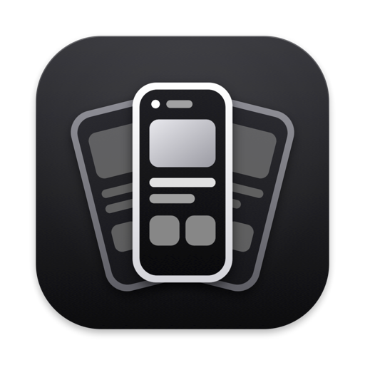
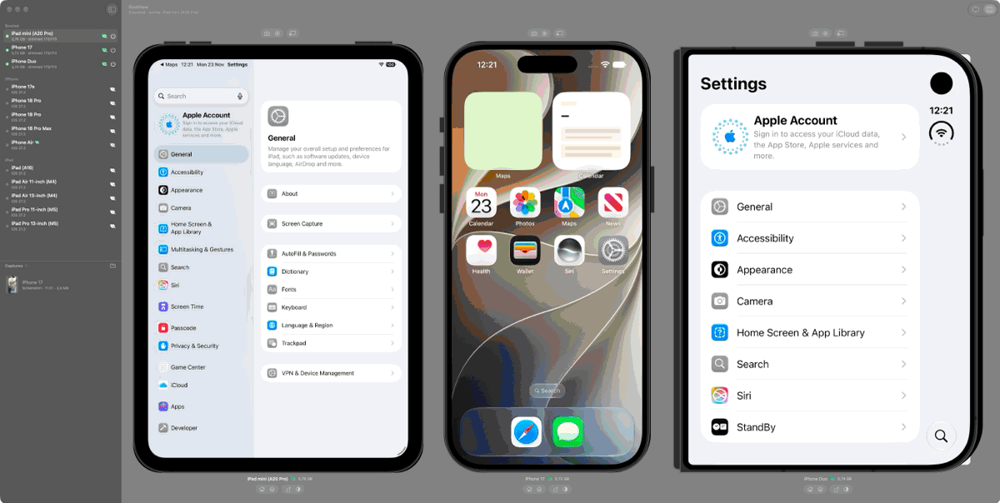

<p align="center">
  
</p>

<h1 align="center">SimView</h1>

<p align="center">
  <strong>All your iOS simulators in one window. 4× lighter. Driven by your AI agents.</strong>
</p>

<p align="center">
  <a href="#install">Install</a> ·
  <a href="#why-its-light">Why it's light</a> ·
  <a href="#mcp-server-for-ai-agents">MCP server</a> ·
  <a href="#features">Features</a> ·
  <a href="CHANGELOG.md">Changelog</a>
</p>

<p align="center">
  <a href="https://github.com/jowhg/simview/actions/workflows/build.yml"></a>
  <a href="https://github.com/jowhg/simview/releases/latest"></a>
  <a href="LICENSE"></a>
  <a href="https://github.com/jowhg/simview/stargazers"></a>
</p>



A stock iOS simulator boots around 180 background services (Siri, Spotlight indexing, photo analysis, iCloud
sync…) and sits on about **4 GB of RAM** doing nothing you need. SimView boots yours **slim**: the same simulator
runs in about **0.9 GB**. Then it shows every one of them live, side by side, in one window, and lets your AI
agents drive them.

- 🪶 **~4× lighter simulators.** Slimmed as they boot. A 16 GB MacBook runs a dozen instead of five.
- 🪟 **One window, every device.** Live, full frame rate, in Xcode's real bezels: tap, swipe, type, rotate.
- 🤖 **Built for agents.** `simview-mcp` gives Claude Code, Cursor & co. 40 tools to see and drive them.
- 📌 **Pop out and float.** Detach a device and keep it on top of your full-screen editor.
- 📦 **Drop to install.** Drag a `.app`, an `.ipa`, photos or videos onto a device.
- ⚡️ **Native and tiny.** A 3 MB SwiftUI app. No Electron, no web view, no account.

## Install

```sh
brew tap jowhg/tap
brew trust jowhg/tap
brew install --cask jowhg/tap/simview
```

Homebrew asks you to trust a tap before installing from it: that is the `brew trust` line. This installs `SimView.app` in `/Applications` and puts `simview-mcp` on your `PATH`. Update with
`brew upgrade --cask simview`, remove with `brew uninstall --cask simview` (add `--zap` to also remove its settings).

You need **Xcode 27** with the iOS simulator runtime (see [Requirements](#requirements)).

**First launch.** SimView is not notarized by Apple, so macOS blocks it the first time. Open it once, then go to
System Settings › Privacy & Security and click **Open Anyway**.

Prefer a direct download? Grab `SimView-x.y.z.zip` from the [latest release](https://github.com/jowhg/simview/releases/latest),
unzip it and move `SimView.app` to `/Applications`; `simview-mcp` is then at
`/Applications/SimView.app/Contents/Helpers/simview-mcp`. Or [build it from source](#build-from-source).

## Why it's light

Simulators are heavy because they boot a whole iOS, background daemons included. SimView uses
[simslim](https://github.com/mobai-app/simslim) to switch off the ones development and testing never need, as
each simulator boots. It's on by default: turn it off in Settings (⌘,), or boot a single simulator standard from its
context menu.

| One simulator, fresh boot | Stock | Slim |
| --- | --- | --- |
| Background services | ~180 | 173 of them switched off |
| Memory (phys_footprint) | 4.0 GB | 0.9 GB |

<sub>Figures from [simslim's benchmark](https://github.com/mobai-app/simslim#numbers) (M1 Pro, 16 GB). A slimmed
simulator still runs your app, the keyboard, Settings, Safari and Maps; features that need a switched-off service
(Photos, iCloud, Siri…) can be kept with simslim's profiles. Running apps add their own memory on top.</sub>

The Homebrew cask installs simslim for you. Without it, SimView still works, with stock simulators.

## Features

**The app**

- **Live multi-device row.** Every booted simulator, side by side, at full frame rate, straight from
  CoreSimulator's framebuffer. Mouse clicks and drags are touches (dragging in from a screen edge triggers
  Home, App Switcher and Control Center gestures), the Mac keyboard types into the device, and the buttons drawn
  on the bezel (volume, side, Action) can be clicked.
- **Two layouts.** *Full height*: every device as tall as the window allows, scroll sideways if they do not fit.
  *Fit all*: zoomed out so the whole row fits without scrolling.
- **Drag the bezel to resize** a device (35 to 100 % of full height); double-click the bezel to reset it.
- **Detachable device windows.** Pop a device out into its own window, like the old Simulator.app: the bezel on a
  transparent background under a floating title bar. Drag the title bar to move it, the bezel to resize it;
  proportions are kept and the position is remembered across launches. Optionally keep it above every other app,
  full-screen ones included, to code side by side on a single screen. Close the window to put the device back.
- **Rotation.** Turn a device left or right (⌘← / ⌘→); the bezel turns with it and touches stay where you click.
  Rotations made elsewhere (by an agent through `simview-mcp`, for instance) show up within a couple of seconds.
- **Drag and drop onto a device.** Drop a `.app` or a simulator `.ipa` to install it (and open it), photos and
  videos to add them to Photos. Several files at once; errors are reported, never swallowed.
- **English and French**, following the system language or chosen in Settings (⌘,).
- **Sidebar** with every simulator on the Mac: boot / shut down, RAM used by each booted one.
- **Captures panel.** Screenshots and screen recordings (H.264 MP4) go to `~/Pictures/SimView`, named after the
  device and time. The panel lists them with thumbnails and follows changes made in Finder; drag them out, copy,
  open, reveal or trash them.
- **Clipboard sync** between the Mac and every device, in both directions: what you copy on the Mac reaches the
  devices, what you copy on a device reaches the Mac (right after Cmd+C / Cmd+X, and when you leave the device).
  So that Cmd+V is not stopped by iOS's paste prompt, SimView sets "Paste from Other Apps" to Allow for the
  device's apps.
- **[simslim](#simslim-optional) integration.** If `simslim` is installed, each device shows whether it is slimmed and
  can be slimmed / restored from the sidebar or its footer.

**Keyboard shortcuts** (Simulator.app's, acting on the active device)

| Shortcut | Action |
| --- | --- |
| ⌘1 / ⌘2 | Full height / Fit all layout |
| ⇧⌘D | Detach the device into its own window / put it back |
| ⌥⌘T | Keep the detached window on top |
| ⇧⌘H | Home |
| ⌃⇧⌘H | App Switcher |
| ⌘L | Lock |
| ⌘← / ⌘→ | Rotate left / right |
| ⌘↑ / ⌘↓ | Volume up / down |
| ⇧⌘A | Toggle light / dark appearance |
| ⌃⌘Z | Shake |
| ⌘S | Screenshot |
| ⌘R | Start / stop screen recording |

## MCP server for AI agents

`simview-mcp` speaks MCP over stdio. It does not need the SimView app to be running: it talks to CoreSimulator,
`simctl`, `devicectl` and the simulator's touch service directly. Every tool takes an optional `simulator`
(UDID or exact name), which can be left out when only one simulator is booted. Screenshots come back at one pixel
per point, so coordinates read off the image can be passed straight to `tap` and `swipe`.

40 tools:

| Group | Tools |
| --- | --- |
| Simulators | `list_simulators`, `boot_simulator`, `shutdown_simulator`, `slim_simulator`, `unslim_simulator` |
| Screen | `screenshot`, `get_screen_info`, `wait`, `start_recording`, `stop_recording` |
| Touch | `tap`, `double_tap`, `long_press`, `swipe` (edge gestures included), `scroll`, `pinch` |
| Keys and buttons | `type_text` (US QWERTY and French AZERTY, accents included), `press_key`, `press_button`, `rotate`, `shake` |
| Apps | `list_apps`, `launch_app`, `terminate_app`, `install_app`, `uninstall_app`, `open_url`, `get_app_container` |
| Environment | `set_location`, `clear_location`, `set_appearance`, `set_content_size`, `set_permission`, `send_push`, `override_status_bar`, `clear_status_bar`, `add_media` |
| Clipboard and logs | `set_clipboard`, `get_clipboard`, `get_logs` |

Actions accept `screenshot: true` to return the resulting screen in the same call.

Note that `set_clipboard` also replaces the Mac's clipboard (the simulators mirror it).

**Claude Code**

```sh
claude mcp add simview -- simview-mcp
```

**Other MCP clients** (Claude Desktop, Cursor, …): add it to the client's MCP configuration:

```json
{
  "mcpServers": {
    "simview": {
      "command": "simview-mcp"
    }
  }
}
```

Installed with Homebrew, `simview-mcp` is on your `PATH`. Otherwise use its full path:
`/Applications/SimView.app/Contents/Helpers/simview-mcp`, or `build/simview-mcp` in a source checkout. Some clients
(Claude Desktop) don't see your shell's `PATH`: give them the full path, e.g. `/opt/homebrew/bin/simview-mcp`.

## Requirements

- **Xcode 27** with the iOS simulator runtime. SimView uses the Xcode `xcrun` would use: `$DEVELOPER_DIR`, else
  the one picked with `xcode-select -s` (if that is the Command Line Tools, it falls back to `/Applications/Xcode*.app`). Input goes through the simulator's `dtuhidd` service (the path Xcode 27 uses), and device
  bezels come from Xcode's DeviceKit chrome in `/Library/Developer/DeviceKit`; older Xcode versions are not
  supported.
- **macOS**: the app's deployment target is macOS 14, but in practice you need a macOS version that runs Xcode 27.
  Tested on macOS 27.2 with Xcode 27.2, on Apple silicon.

### simslim (optional)

[`simslim`](https://github.com/mobai-app/simslim) turns off the background iOS services a test run does not need,
cutting a simulator's memory use. SimView and `simview-mcp` look for it at `/opt/homebrew/bin/simslim` or
`/usr/local/bin/simslim`:

```sh
brew install mobai-app/tap/simslim
```

## Build from source

Needs Xcode 27 (`swiftc`, `clang`, `codesign` and `xcstringstool` come with it).

```sh
git clone https://github.com/jowhg/simview.git
cd simview
./build.sh
```

This produces:

- `build/SimView.app`: the app (ad-hoc signed). Open it, or copy it to `/Applications`.
- `build/simview-mcp`: the MCP server binary.

There is no Xcode project; `build.sh` calls `clang` and `swiftc` directly. `VERSION=1.2.3 ./build.sh` stamps a
version into the app. `simview-mcp` is also copied into the app (`SimView.app/Contents/Helpers/simview-mcp`).

### Releasing

1. Add the version's notes to [CHANGELOG.md](CHANGELOG.md), then tag it: `git tag v1.2.3 && git push origin v1.2.3`.
2. The [Build](.github/workflows/build.yml) workflow builds `SimView-1.2.3.zip`, publishes the GitHub release and
   prints the cask's new `version` and `sha256` in its summary.
3. Put them in `Casks/simview.rb` in [jowhg/homebrew-tap](https://github.com/jowhg/homebrew-tap) (the
   template is [packaging/homebrew/simview.rb](packaging/homebrew/simview.rb)).

## Caveats

- **Private Apple frameworks.** SimView uses CoreSimulator, Xcode's DeviceKit chrome and the simulator's
  `dtuhidd` service, none of which are public API. Any Xcode update can break it. For the same reason it cannot be
  distributed on the Mac App Store.
- **Unsigned builds.** Builds are ad-hoc signed, not notarized. If macOS refuses to open a downloaded copy,
  allow it once in System Settings › Privacy & Security › "Open Anyway", or run:

  ```sh
  xattr -dr com.apple.quarantine /path/to/SimView.app
  ```

## Repository layout

| Path | Contents |
| --- | --- |
| `app/` | SwiftUI app |
| `core/` | Objective-C core: CoreSimulator access, live screen, device chrome, clipboard sync |
| `dtuhid.m`, `dtuhid.h` | Touch, button and keyboard input through `dtuhidd` (shared by the app and the MCP server) |
| `mcp/main.swift` | `simview-mcp` |
| `assets/` | App icon sources (SVG); `assets/make-icon.sh` rebuilds `app/AppIcon.icns` from them |
| `packaging/homebrew/` | The Homebrew cask, as published in the tap |
| `bench/` | Benchmark scripts used during development (CPU, memory and FPS compared with Xcode's device viewer) |

## Acknowledgements

The `dtuhidd` wire format and connection recipe follow [idb](https://github.com/facebook/idb)'s DTUHID transport
(MIT).

## License

[MIT](LICENSE)

SimView is not affiliated with or endorsed by Apple Inc. iOS, Xcode and Simulator are trademarks of Apple Inc.
